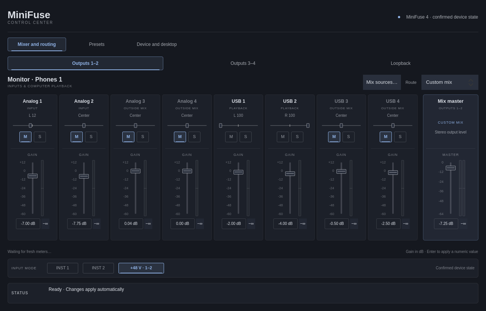

# MiniFuse Control for Linux

A standalone Qt Quick application for the MiniFuse Linux control platform,
with an optional, separately usable desktop activation agent. It connects to
[mf-service](https://github.com/srdiogo/mf-service); all device semantics, verification and recovery remain in
`mf-core`. Omarchy is optional.

**Status: development preview with bounded MiniFuse 4 hardware validation.** The application includes all three MF4 mixer views, routes,
source membership, configured levels/pan, mute/solo, host presets and operation
recovery. Building/testing does not install startup entries or change hardware.



*Qt capture of the installed application using a recorded MiniFuse 4 readback.
Live meter samples are not replayed in this documentation image. The application
follows the system palette; this capture illustrates a dark palette.*

## Run

Requires Linux, Python 3.12–3.14, PySide6 6.11.2 and the service revision pinned
in [contract.lock.json](contract.lock.json). Normal device control also requires
the matching administrator-installed MiniFuse kernel module and existing user
access. The GUI does not install or replace those components.

```sh
python3 -m venv .venv
.venv/bin/pip install '.[gui]'
.venv/bin/minifuse-control
```

The mixer uses aligned vertical channel strips, a separate master and compact
input-mode buttons, sharing a visual language with the optional Omarchy panel.
Colors follow the system Qt palette. Short windows use a compact layout; source
channels scroll horizontally while the master remains visible. Mix sources are
managed from **Mix sources…**, and routes remain beside the destination heading.

The application reads state on connection and follows service events. Faders
and pan apply while moving, with bounded coalescing and a final release value.
Numeric levels apply on Enter; mute/solo, routes and membership apply on click.
Manual refresh is under Device and desktop → Show local diagnostics. Preset
restore keeps a comparison and an explicit Apply step.

The backend currently exposes the validated MF4 mixer only. MF1/MF2 keep their
established CLI controls; this app does not infer MF4 layouts for them.
MF4 INST1, INST2 and shared +48 V use confirmed readback, including physical
button changes. Clicking applies a verified change when the active module
advertises input-switch support; an older module provides read-only indicators.
Calibrated source and post-master mix peaks appear alongside the faders in dBFS.
They use device C2 readback, with a 500 ms freshness timeout. Mix peaks precede
destination routing and can differ from physical outputs on USB direct.
Logo-button activation remains unavailable. A configured gain is not a signal
meter. Effects, firmware/device-storage writers and system audio routing
changes are outside scope.

## Development and validation

```sh
.venv/bin/pip install '.[gui,dev]'
.venv/bin/ruff check src tests --select E4,E7,E9,F
.venv/bin/ruff format --check src tests
QT_QPA_PLATFORM=offscreen QT_QPA_PLATFORMTHEME= QT_QUICK_CONTROLS_STYLE=Basic QT_QUICK_BACKEND=software .venv/bin/python -m unittest discover -s tests -v
.venv/bin/pyside6-qmllint src/minifuse_control/qml/*.qml
.venv/bin/pip wheel --no-deps . -w dist
```

Tests use the canonical real-service contract and deterministic local socket
peers. There is no fake device mode in the normal application. Bounded hardware integration has been exercised on one MF4. Broader hardware,
Wayland focus/scaling and clean-machine package acceptance remain separate gates.

## Documentation

- [Application architecture and interaction](docs/APPLICATION.md)
- [Desktop agent and physical-button activation](docs/DESKTOP.md)
- [Implementation and validation](docs/IMPLEMENTATION.md)
- [Installation, optional integration and removal](docs/INSTALL.md)
- [Contribution workflow](CONTRIBUTING.md)

The canonical [protocol](https://github.com/srdiogo/mf-service/blob/main/docs/IPC.md)
and [continuous interaction contract](https://github.com/srdiogo/mf-service/blob/main/docs/LIVE_CONTROLS.md)
are maintained by the service. Client fixture copies are pinned
by source commit and SHA-256 rather than maintaining a separate API.

The Python distribution has no unconditional Qt dependency. Install the `gui`
extra for the application; the standard-library desktop agent can be packaged
without it. The default activation preference is disabled. Preferences never
install startup or enable an unvalidated hardware event.

New material is [MIT licensed](LICENSE). Design/research comes from srdiogo's
MiniFuse CC work and the `mf-cli` evidence record, which retains upstream
contributor credits. This is an independent community project.
