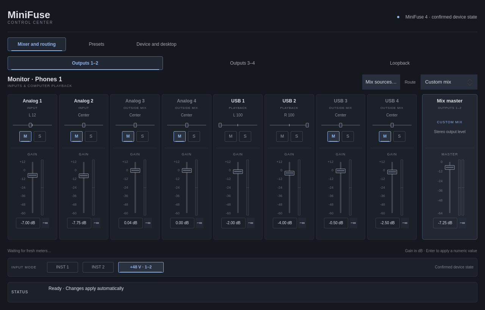

# MiniFuse Control

**Control your Arturia MiniFuse hardware mixer on Linux. Live meters, routing, input controls and presets.**

[](https://github.com/srdiogo/minifuse-control/actions/workflows/ci.yml)

Part of **MiniFuse for Linux**, an independent community project. The application
reads your interface when it connects and follows hardware changes. Drag a
fader, change a route or click a supported input control to apply it directly.



*Installed application using a recorded MiniFuse 4 readback. The application
follows the system palette; this capture uses a dark palette. Live meter samples
are not replayed in this documentation image.*

[Install](#install) · [Compatibility](#compatibility) · [Get help](SUPPORT.md) · [Contribute](CONTRIBUTING.md)

## Your mixer, on Linux

- Three MiniFuse 4 mixer views with vertical faders and a separate master.
- Source levels, pan, mute/solo, mix membership and destination routing.
- INST1, INST2 and shared +48 V controls with confirmed state, including physical button changes.
- Calibrated source and post-master mix meters.
- Preset comparison and deliberate restore from files on your computer.
- System colors, keyboard controls and a layout that adapts to smaller windows.

The application uses [MiniFuse Backend](https://github.com/srdiogo/minifuse-backend)
for hardware control. Omarchy is optional; its
[compact panel](https://github.com/srdiogo/omarchy-minifuse) is a separate frontend.

## Install

**Arch Linux x86_64:** download the archive and checksum from the
[complete installation preview](https://github.com/srdiogo/minifuse-backend/releases/tag/installer-preview-2026-10-29).
Verify and extract it, then select the application profile:

```sh
sha256sum -c minifuse-linux-installer-2026-10-29.tar.gz.sha256
tar -xzf minifuse-linux-installer-2026-10-29.tar.gz
cd minifuse-linux-installer-2026-10-29
./install.sh --profile gui
```

Run as your normal graphical-session user. This installs the driver, service
and application without the Omarchy panel. Setup displays its plan before
confirmation, prepares matching kernel headers and configures boot/login
startup. The published GUI packages require Python 3.14.

On Omarchy, use `./install.sh --profile full` to include the panel and floating
application-window setup. For existing installations, custom kernels, startup
options, updates or removal, read the
[installer guide](https://github.com/srdiogo/minifuse-backend/blob/main/distribution/INSTALLER.md)
and [application installation guide](docs/INSTALL.md).

Ubuntu, Debian and Fedora packages are planned. The current complete installer
supports Arch Linux x86_64; a Python wheel alone does not install the required
driver or service. See the
[distribution roadmap](https://github.com/srdiogo/minifuse-backend/blob/main/docs/DISTRIBUTION.md).

## Model-support testing

This test revision selects the correct input and native loopback layout for
MiniFuse 1, MiniFuse 2 and MiniFuse 2 OTG. The backend checks the USB firmware
descriptor, exact state and matching driver capabilities before enabling native
loopback. Candidate families are MF1/MF2 1.5.x and OTG 1.0.x; unknown or
unreviewed families stay unavailable. Explicit opt-in is required, and physical
acceptance is still pending for every new model. MF4 retains its existing
independent mixer. The installer preview linked above predates these additions.

We are looking for owners of MF1, MF2 and MF2 OTG to help with LED checks,
readbacks and minimal Windows USB captures. Follow the backend's
[hardware acceptance guide](https://github.com/srdiogo/minifuse-backend/blob/feature/model-controls/docs/models/TESTING.md).
Static analysis and synthetic frontend fixtures are not physical validation.
See [model layouts and boundaries](docs/MODELS.md) for controls and limitations.

## Compatibility

| Area | Current status |
|---|---|
| MiniFuse 4 | Bounded hardware validation of mixer, routes, input controls and meters |
| MiniFuse 1 / 2 / 2 OTG | Experimental native loopback mixer, routing, meters and host presets; model/firmware gates and hardware acceptance pending |
| Desktop | Standalone Qt Quick application; Omarchy is optional |
| Application runtime | Python 3.12–3.14; source GUI extra pins PySide6 6.11.2 |
| Native packages | Arch Linux x86_64; GUI checked with Qt 6.11.2 and 6.12.0 |

**Development preview.** Optional MF4 short-press logo activation requires a compatible backend, validated USB firmware descriptor 1.0.1 and the desktop agent. Effects,
firmware changes and device-storage writes are outside scope. Unsupported
controls remain unavailable rather than using a guessed model layout.
MF4 meter peaks are measured before destination routing and may differ from the
physical outputs when USB direct routing is selected. New-model meters follow
the native input/loopback layout and still need physical channel/scale checks.

## First launch

Open **MiniFuse Control** from your application launcher. The app reads the
device before enabling controls. If the service is unavailable, use
**Device and desktop** for local diagnostics; `minifuse-doctor` also checks the
backend without changing device settings.

Faders and pan apply during movement, and numeric levels apply on Enter.
Preset restore keeps a comparison and an explicit **Apply** step. Reconnecting
reads fresh state; it does not restore a preset automatically.

## Documentation and community

- [Installation, updates and removal](docs/INSTALL.md)
- [Support and troubleshooting](SUPPORT.md)
- [Development and tests](docs/DEVELOPMENT.md)
- [Application architecture](docs/APPLICATION.md) and [validation status](docs/IMPLEMENTATION.md)
- [Optional desktop agent](docs/DESKTOP.md) for validated MF4 short presses
- [Changelog](CHANGELOG.md) and [contributing](CONTRIBUTING.md)
- [MiniFuse Backend](https://github.com/srdiogo/minifuse-backend) and [MiniFuse for Omarchy](https://github.com/srdiogo/omarchy-minifuse)

## Credits and license

This is an independent community project, not an official Arturia product.
New material is [MIT licensed](LICENSE). Design and research come from srdiogo's
MiniFuse CC work and the `mf-cli` evidence record, which retains upstream
contributor credits. Protocol and hardware attribution are preserved in the
[backend evidence record](https://github.com/srdiogo/minifuse-backend/blob/main/docs/mf4/evidence.md).
